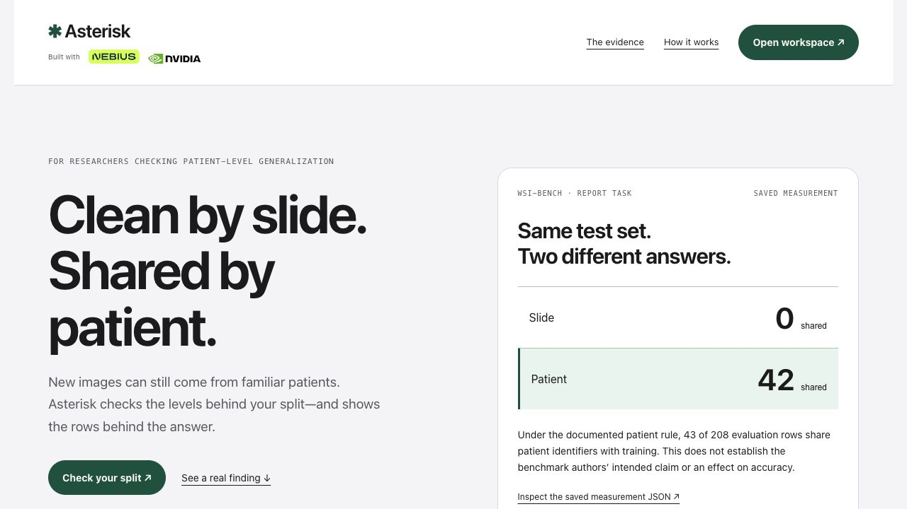

# Asterisk

**Know what your test set actually holds out.**

Asterisk helps researchers check whether a train/test split separates the recorded units their claim depends on. Review a documented identity rule, measure overlap at multiple levels, and keep the source-row evidence in a portable receipt.

**NVIDIA Nemotron** on **Nebius Token Factory** proposes cited rules; application code measures overlap, and **Nebius Sandboxes** can replay the computation.

[Try Asterisk](https://asterisk.gowthamsarveswaran.com/public/) · [Watch the 2:58 demo](https://youtu.be/zOhpzwFIz_g) · [Open the workspace](https://asterisk.gowthamsarveswaran.com/static/ladder.html#receipt) · [Run locally](#run-locally)



*Research preview. The public page opens without login; the hosted workspace requires reviewer credentials.*

## Why the unit matters

New images do not necessarily mean new patients. An evaluation that separates files can still share the subjects those files came from.

In pinned public WSI-Bench report-task files, Asterisk measured:

| Recorded unit | Shared between training and evaluation |
| --- | ---: |
| Slide identifier | **0** |
| Patient identifier | **42** |

Under the documented TCGA patient rule, **43 of 208 evaluation rows** share patient identifiers with training. A patient is derived from the first 12 characters of the slide filename. This checks a stated patient-level condition; it does not establish the benchmark authors’ intended claim or an effect on model accuracy.

[Inspect the saved measurement and witnesses](static/ladders/wsibench-report.json) · [Read the recorded patient definition](examples/ladders/docs/tcga-barcode.md)

## Run locally

**Requires Python 3.14 and Git.** Node.js is needed only for the JavaScript tests. Local measurement needs no model credentials, Sandbox access or GPU.

```sh
git clone https://github.com/gowtham0992/asterisk.git
cd asterisk
python3.14 -m venv .venv
.venv/bin/python -m pip install -r requirements.lock.txt
.venv/bin/python -m uvicorn app.main:app --host 127.0.0.1 --port 8791
```

Open **http://127.0.0.1:8791/static/ladder.html#check**:

1. Expand **Advanced → Measure a ladder spec you wrote yourself**.
2. Select **Load subject-disjoint example**, then **Measure on server**.
3. Expect **No shared values, pending your confirmation**.
4. Read the partition mapping, identity definition and cited documentation. Confirm the fictional subject definition and measure again to see **Held out**.
5. Choose **Save to workspace** and reopen the receipt under **Independence ladders**.

The supplied example is fictional. No inference or remote execution occurs along this path. To see an overlap finding instead, load **Load overlapping-subject example** and measure it.

## Check your own split

Use **New check** at `/static/ladder.html#propose`.

1. **Define.** State what must be unseen in training, such as “No evaluation patient appears in training.” Add split files and documentation.
2. **Review the payload.** Choose file roles and the identifier examples that may be sent to the model. Preview the exact outbound request.
3. **Review the rule.** Nemotron proposes extraction rules with line citations. Inspect the partition assignments, source passages and row-to-unit examples. Correct the proposal or use **Define the unit yourself**.
4. **Measure.** Application code computes overlap at the declared levels. Open a witness to inspect the training and evaluation source references.
5. **Retain.** Optionally replay in a fresh Nebius Sandbox, save the receipt and export the evidence.

Supported inputs include **CSV tables, JSON arrays of records, newline-delimited lists and text documentation**. Supported rules include columns, filename parsing, character ranges and metadata lookups. Inputs are bounded to **80 files and 16 MB total**, with up to **100,000 records per source**. Uploaded research code is not executed.

You can define a rule manually without a model call. Advanced users can supply an `asterisk-ladder/1` specification and the files it references; [the example specification](static/ladder-example/spec.json) shows the format.

## Enable Nemotron proposals and Sandbox replay

Both capabilities are optional. For local development, create `.env` only if it does not already exist:

```sh
test -f .env || cp .env.example .env
```

Set these values locally, then restart the server:

```dotenv
NEBIUS_API_KEY=your-nebius-api-key
NEBIUS_PROJECT_ID=your-nebius-project-id
```

Never commit `.env`. The app reads these provider credentials from `.env` or the process environment. Sandbox access must be enabled for the project to use remote replay.

| Capability | What it does | Configuration |
| --- | --- | --- |
| Nemotron proposal | Reads the selected documentation and proposes a cited rule | Nebius API key; choose Super or Ultra in the form |
| Local measurement | Computes exact overlap using application code | No provider credentials |
| Sandbox replay | Runs the same measurement in a fresh isolated environment | Nebius API key, project ID and Sandbox access |
| Save and export | Retains the result and produces downloadable evidence | No new provider call |

The default model is **NVIDIA Nemotron 3 Super**, through **Nebius Token Factory**. Ultra remains selectable. The model proposes an interpretation; application code computes the measurement. A validator can request one repair. Neither schema validation nor a successful dry run verifies scientific meaning.

The application itself is a Python web service; it does not require a local GPU. The hosted preview runs on AWS, with Nebius providing inference and Sandbox execution.

## Understand the result

| Result | Meaning |
| --- | --- |
| **Not held out** | A recorded identity occurs in both selected partitions under the stated rule; inspect its witnesses. |
| **No shared values, pending your confirmation** | The measured values do not overlap, but their meaning and partition interpretation still need confirmation. |
| **Held out** | The required coverage and checks pass under the recorded rule and the person’s confirmed interpretation. |
| **Not established** | Structural ambiguity or other conditions prevent establishing the claim; review the explanation. |
| **Insufficient evidence** | The supplied evidence does not support a definitive answer at the claim level. |

A confirmation records the reviewer’s assertion. It is not independent scientific validation. Near-unique identifiers and incomplete mappings need particular attention: a per-sample ID can make subject overlap impossible to detect.

## Save, export and recompute

Saved receipts retain the input files, extraction specification, full measurement, witness references and recorded confirmations. When linked to a server-recorded proposal, they also retain the model, prompt version, request hash, validation-attempt metadata and edit/input-change flags. They do not retain full model reasoning.

Receipts belong to the browser session’s owner. Export anything you need to retain before clearing session cookies. Records and inputs can be deleted from the workspace.

- **Readable HTML:** a self-contained view of the result, rules, citations, witnesses and provenance; opens locally.
- **Measurement JSON:** the structured record for inspection and reuse.
- **Evidence ZIP:** an explicit opt-in export that also includes every uploaded source file, including fields not shared with the model.

To recompute a ZIP, use a separately obtained and trusted matching Asterisk installation:

```sh
.venv/bin/python -m asterisk verify-ladder /absolute/path/to/bundle.zip
```

Verification uses the installed checker without credentials, network access or executing bundled code. Exit `0` means the measurement matches, even when it finds overlap; exit `2` means verification failed. Recorded confirmations are reused, not independently endorsed.

A matching Sandbox replay demonstrates **same-code reproducibility**. The receipt is unsigned; hashes and replay do not authenticate the original data, the author or scientific meaning.

## Data handling

Choosing files reads them in the browser. **Preview and measurement upload the selected files to the Asterisk server.** The model receives the text marked as documentation, column summaries and the selected example values shown in the outbound preview.

A Sandbox replay separately uploads the checker, specification, confirmations and supplied files. This can include fields that were not sent to the model. Use only authorized inputs and do not send personal or sensitive data to the Sandbox beta.

The real WSI-Bench loader uses an identifier-only projection, excluding clinical conversations and question IDs. For your own files, prepare an appropriate projection before uploading; Asterisk does not automatically remove personal fields from arbitrary inputs.

## Load the real benchmark locally

The saved public result is included in the source. The interactive **Run this check yourself on the same files** action additionally needs a local identifier cache. A fresh clone without it displays an unavailable message; the fictional examples and own-file workflow still work.

1. Obtain the two pinned report-task files listed in [the source inventory](examples/ladders/sources.json).
2. Keep the filenames `wsibench/Report_all_type_all_train_single.json` and `wsibench/Report_all_type_all_test_single.json` beneath a local source-data directory.
3. Build the projection into a new, empty output directory:

```sh
.venv/bin/python -m scripts.build_wsibench_demo \
  --data /absolute/path/to/source-data \
  --output .data/benchmarks/wsibench
```

The builder checks the pinned source hashes and keeps image identifiers only. Raw source files and the generated cache stay outside Git. For a custom cache location, export `ASTERISK_BENCHMARK_DIR` as the **absolute parent directory containing `wsibench/`** before starting the server. Additional host configuration is supplied through environment variables; `.env` loading is limited to provider settings.

## Evidence and limitations

The shipping Super v4 prompt scored **5/10 on retained preparation set D**, below its performance threshold. A later control elicited an unsupported binding despite documentation denying its meaning. Model proposals require review even when they are executable. The guided manual path remains available.

Asterisk measures **exact recorded identifiers under declared derivations**. It does not detect image similarity, undocumented identity links or preprocessing leakage, and does not quantify accuracy effects. Researcher usefulness, time saved and adoption remain unmeasured.

[Retained model evaluation](evaluation/ladder-proposal-v5/RESULTS.md) · [Later reliability exception](docs/submission/line-bounds-comparison-2026-10-07.md) · [Workflow verification](docs/submission/receipt-first-2026-10-23.md)

## Development and deployment

```sh
.venv/bin/python -m pytest -q tests
node --test tests/*.test.mjs
```

Provider calls in automated tests are mocked. Some HTTP tests require permission to bind localhost; scientific-trace tests cover disabled historical categories and can skip in the main environment. Recorded verification details are linked above.

For hosting, use `ASTERISK_HOSTED_WORKFLOW=ladder` with `scripts/start_hosted.sh`, HTTPS, persistent storage and explicit preview authentication. Configure provider usage limits before enabling remote calls. The hosted preview uses finite call reservations; it is not unlimited testing or a production account system. See [host configuration and rollback](docs/release.md).

[Current product records](docs/current-readiness.md) · [Ladder implementation handover](docs/submission/HANDOVER-ladder.md) · [Historical single-binding guide](docs/history/single-binding-readme-2026-10-23.md)

## License

Application code is available under the [MIT License](LICENSE). Dataset and third-party source licenses remain their own. Release packages exclude credentials, databases, private model replies and raw research datasets.

Built for the **Nebius × NVIDIA Global AI Hackathon — Best Apps and Agents**.
